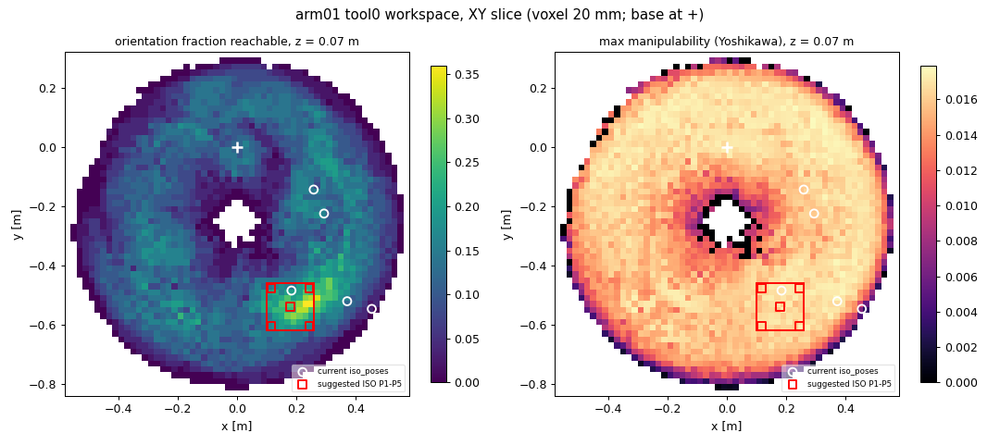
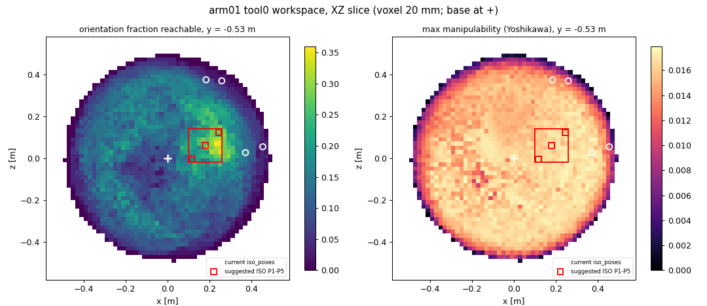
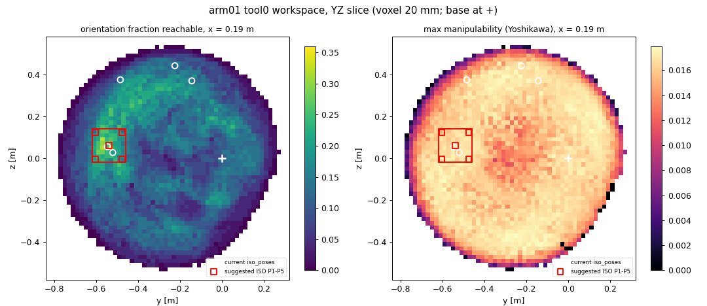
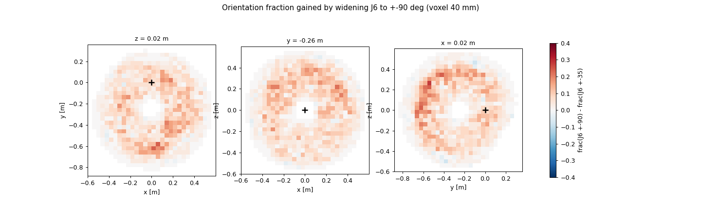

# arm01 workspace and reachability map

Generated by `tools/workspace_map.py` (voxel 20 mm, 3000000 forward samples, 50 reference orientations, 3210808 IK targets, 464 s). Data: `docs/workspace/workspace.npz`.

Per voxel: *reachable* (some tool position in it), *frac* (share of 50 orientations spread over SO(3) the IK reaches with tool0 at the voxel center), *manip* (max Yoshikawa sqrt(det JJ^T) of the 6x7 tool Jacobian). Base frame coordinates.

## Volume

| quantity | value |
|---|---|
| reachable volume | 0.723 m^3 (90358 voxels) |
| volume with frac >= 0.1 | 0.3462 m^3 |
| volume with frac >= 0.2 | 0.0239 m^3 |
| volume with frac >= 0.3 | 0.0004 m^3 |
| volume with frac >= 0.4 | 0.0000 m^3 |
| frac percentiles 10/25/50/75/90/99 | 0.00 / 0.04 / 0.08 / 0.12 / 0.16 / 0.22 |
| max frac | 0.36 |
| reachable voxels with frac = 0 (all / interior) | 9631 / 2738 |

## Dexterous region and ISO 9283 cube

Largest axis-aligned cube whose voxels all reach at least the given orientation fraction:

| frac >= | side | center [m] | mean frac |
|---|---|---|---|
| 0.11 | 160 mm | (0.180, -0.540, 0.060) | 0.21 |
| 0.2 | 80 mm | (0.220, -0.540, 0.080) | 0.28 |
| 0.3 | 20 mm | (0.250, -0.530, 0.070) | 0.36 |
| 0.4 | none | | |

Dexterous threshold used: frac >= 0.11.

Suggested ISO 9283 poses: cube side 160 mm centered at (0.180, -0.540, 0.060); P1 center, P2-P5 on the diagonal plane 10% in from its corners; one tool orientation for all five (best worst-case manipulability among 400 candidate orientations, 19 feasible at all five); per point the best-conditioned IK solution at least 8 deg from every joint limit. Gravity load under 60% of max torque (the mocap_repeat rule): all.

| pose | tool [m] | q [deg] | manip | sigma_min | cond | min clearance |
|---|---|---|---|---|---|---|
| P1 | (0.180, -0.540, 0.060) | -37, 45, -51, 97, 79, 26, -37 | 0.0151 | 0.101 | 18 | 9 deg (forearm_yaw) |
| P2 | (0.116, -0.604, -0.004) | -42, 63, -27, 55, 52, 24, -77 | 0.0104 | 0.051 | 35 | 11 deg (wrist_yaw) |
| P3 | (0.116, -0.476, -0.004) | -70, 44, -30, 116, 63, -1, -59 | 0.0126 | 0.117 | 15 | 10 deg (shoulder_pitch) |
| P4 | (0.244, -0.476, 0.124) | -71, 92, -47, 114, 31, -20, -42 | 0.0074 | 0.079 | 24 | 9 deg (shoulder_pitch) |
| P5 | (0.244, -0.604, 0.124) | -18, 84, -22, 53, 51, 22, -50 | 0.0067 | 0.040 | 44 | 13 deg (wrist_pitch) |

For `validation.iso_poses_rad` in config/arms/arm01.yaml (applied):

```yaml
iso_poses_rad:
  - [-0.6382, 0.7926, -0.8818, 1.6907, 1.3753, 0.4556, -0.6538]
  - [-0.7324, 1.1009, -0.4689, 0.9683, 0.9153, 0.4260, -1.3491]
  - [-1.2196, 0.7760, -0.5157, 2.0172, 1.0959, -0.0111, -1.0331]
  - [-1.2459, 1.6004, -0.8126, 1.9875, 0.5424, -0.3564, -0.7259]
  - [-0.3077, 1.4662, -0.3803, 0.9205, 0.8930, 0.3902, -0.8733]
```

## Current `mocap_repeat.iso_poses` (config list empty: feasible random poses, seed 42)

| pose | tool [m] | voxel frac | manip (voxel max) | sigma_min | cond | min clearance | in cube |
|---|---|---|---|---|---|---|---|
| 1 | (0.259, -0.144, 0.370) | 0.12 | 0.0117 (0.0173) | 0.070 | 26 | 21 deg (forearm_yaw) | False |
| 2 | (0.294, -0.225, 0.442) | 0.02 | 0.0116 (0.0125) | 0.053 | 33 | 31 deg (forearm_yaw) | False |
| 3 | (0.455, -0.547, 0.055) | 0.04 | 0.0057 (0.0077) | 0.026 | 67 | 31 deg (elbow) | False |
| 4 | (0.184, -0.485, 0.375) | 0.12 | 0.0073 (0.0159) | 0.059 | 30 | 34 deg (shoulder_roll) | False |
| 5 | (0.372, -0.521, 0.027) | 0.16 | 0.0055 (0.0171) | 0.046 | 40 | 31 deg (elbow) | False |

## Holes

Reachable voxels where none of the 50 reference orientations is reachable, fully surrounded by reachable voxels (largest 6-connected clusters). The reference set is coarse (a random rotation is within 33 deg of its nearest reference at the median, 55 deg at p99), so these are not position holes: the tool gets there, but only with an orientation set narrower than the grid spacing.

| voxels | volume | centroid [m] | distance from base origin |
|---|---|---|---|
| 380 | 3040 cm^3 | (-0.431, -0.104, -0.079) | 0.45 m |
| 267 | 2136 cm^3 | (-0.131, -0.398, -0.140) | 0.44 m |
| 261 | 2088 cm^3 | (-0.014, -0.243, -0.167) | 0.30 m |
| 89 | 712 cm^3 | (0.072, -0.335, 0.031) | 0.34 m |
| 66 | 528 cm^3 | (0.371, 0.096, 0.163) | 0.42 m |

## Effect of the J6 ROM

Actual (J6 +-35 deg) vs J6 widened to +-90 deg, both on a 40 mm grid with the same sampling. Mean orientation fraction over the reachable voxels: 0.082 -> 0.130 (x1.6). Positions only reachable with the wider J6: 0.006 m^3 (of 0.751). Reachable voxels with frac = 0: 1772, of which 188 gain orientations with the wider J6.

| | J6 +-35 | J6 +-90 |
|---|---|---|
| reachable volume [m^3] | 0.763 | 0.751 |
| volume frac >= 0.1 [m^3] | 0.3430 | 0.4779 |
| volume frac >= 0.2 [m^3] | 0.0254 | 0.1976 |
| volume frac >= 0.3 [m^3] | 0.0006 | 0.0335 |
| volume frac >= 0.4 [m^3] | 0.0000 | 0.0004 |
| frac median / p90 / max | 0.08 / 0.16 / 0.34 | 0.12 / 0.26 / 0.42 |

## Slices









